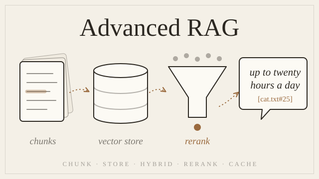

# Advanced RAG



Take a simple RAG and make it production-shaped, one measured step at a time: **chunking**, a **vector database**, **hybrid search**, **reranking**, a **Redis cache**, an **evaluation** set, and a **FastAPI** server, all in plain Python with tests.

Every step shows a **before vs. after table with real measured numbers**, so you can see exactly what each idea buys you.

```
POST /ask {"question": "How long do cats sleep?"}
→ {"answer": "Cats usually sleep 12–16 hours per day … [cat.txt#25]", "cached": false}   3.1 s
→ {"answer": "Cats usually sleep 12–16 hours per day … [cat.txt#25]", "cached": true}    3.7 ms

POST /ask {"question": "What is the capital of France?"}
→ {"answer": "I don't know", "cached": false}                                             324 ms, no LLM call
```

> **Start with the basics?** This builds on **[simple_rag](https://github.com/nettanvirdev/simple_rag)**, where you build keyword search, TF-IDF, BM25, semantic search and a first RAG from scratch.

---

## What you'll learn, and what each step measurably buys

| Technique | The idea in one sentence | Measured on this repo |
|---|---|---|
| **Chunking** | cut long documents into ≤200-token pieces so the embedding model sees all of them | one embedding of `cat.txt` saw **2.5%** of it → **100%** embedded |
| **Vector database** (ChromaDB) | embed every chunk once, store it on disk, embed only the question | **1,482 ms → ~9 ms** per search |
| **Hybrid search** (BM25 + semantic, RRF) | meaning *and* exact words, fused by rank | "Guido van Rossum": wrong file → right file; MRR **0.76 → 0.79** |
| **Redis cache** | the same question twice costs one LLM call | **4,886 ms → 1 ms** on a repeat |
| **Evaluation** | a golden question set with hit rate, MRR and answer checks | found the bottleneck (retrieval) and a real bug |
| **Reranking** (cross-encoder) | a precise second model re-sorts the top 20 candidates | hit rate **89% → 95%**, answers **17/19 → 19/19** |
| **Query rewriting** | the LLM rewrites the question into search words | **no gain** here, +4.5 s per question → kept off, and why |
| **FastAPI** | the whole pipeline as a validated web API | `/ask`, `/search`, `/health`, auto docs at `/docs` |
| **Optimization guide** | proven ideas for speed and cost, with how to measure them | e.g. BM25 **198 ms → 0.2 ms** with precomputation |

## Final evaluation

22 questions (19 the articles answer, 3 they don't) in [`eval/questions.json`](eval/questions.json). Full results, including every answer: **[`eval/results.md`](eval/results.md)**.

| Retrieval method | Hit rate @3 | MRR | ms / question |
|---|---|---|---|
| semantic | 89% | 0.76 | 9 |
| bm25 | 79% | 0.68 | 198 |
| hybrid | 89% | 0.79 | 228 |
| **hybrid + rerank** (used) | **95%** | **0.84** | 379 |
| + query rewriting | 95% | 0.84 | 4,868 |

| Answers (hybrid + rerank, real LLM) | Score |
|---|---|
| Correct | **19/19** |
| Cited a chunk | **19/19** |
| Said "I don't know" when it should | **3/3** |

Reproduce: `uv run python -m advanced_rag.evaluate --answers --rewrite --save`. Numbers will vary slightly with your LLM.

---

## Start learning

📘 **[The step-by-step guide →](docs/advanced-rag/README.md)**: 11 steps. Each has theory, a **before vs. after (measured)** table, a code example, a goal with a checkpoint, tests, and a hidden solution.

⚡ **[Optimization guide →](docs/advanced-rag/optimization/README.md)**: caching, latency, cost and retrieval ideas that work in real systems, each with how to measure it. Kept out of the code on purpose.

🗺️ **[Diagrams →](docs/advanced-rag/diagrams.md)**: where every function and model sits in the indexing and query pipelines.

📐 **[Concepts →](docs/advanced-rag/concepts.md)**: the theory, formulas and a cheat sheet.

| # | Step | # | Step |
|---|---|---|---|
| 1 | [Project setup](docs/advanced-rag/step-01-project-setup.md) | 7 | [Redis cache](docs/advanced-rag/step-07-redis-cache.md) |
| 2 | [Embeddings and dimensions](docs/advanced-rag/step-02-embeddings-and-dimensions.md) | 8 | [Evaluation](docs/advanced-rag/step-08-evaluation.md) |
| 3 | [Chunking: split and pack](docs/advanced-rag/step-03-chunking-split-and-pack.md) | 9 | [Reranking](docs/advanced-rag/step-09-reranking.md) |
| 4 | [Chunking: overlap and records](docs/advanced-rag/step-04-chunking-overlap-and-records.md) | 10 | [Query rewriting](docs/advanced-rag/step-10-query-rewriting.md) |
| 5 | [ChromaDB vector store](docs/advanced-rag/step-05-chromadb-vector-store.md) | 11 | [FastAPI](docs/advanced-rag/step-11-fastapi.md) |
| 6 | [Hybrid retrieval](docs/advanced-rag/step-06-hybrid-retrieval.md) | | |

---

## Setup

### Requirements
- **[uv](https://docs.astral.sh/uv/)**: it installs Python 3.12 for you.
- **Docker**, for Redis (or any Redis 6+ on `localhost:6379`).
- **About 1.5 GB of disk** for PyTorch, the embedding model and the reranker, and internet on the first run.
- **An OpenAI-compatible LLM** for answers (Ollama locally, OpenAI, Groq, OpenRouter, …). Search, reranking and the retrieval evaluation need no API key.

### 1. Install
```bash
git clone https://github.com/nettanvirdev/advanced_rag.git
cd advanced_rag
uv sync
```

### 2. Configure
```bash
cp .env.example .env
```
Set `LLM_API_KEY`, `LLM_BASE_URL` and `LLM_MODEL` for your provider. For a local Ollama: `http://localhost:11434/v1`, key `ollama`. Leave the rest as is.

### 3. Start Redis
```bash
docker run -d --name redis -p 6379:6379 redis:7-alpine
```

### 4. Build the index (once, and again whenever `data/` changes)
```bash
uv run python -m advanced_rag.vectorstore --build
```
This chunks the 4 articles in `data/` into 210 chunks, embeds them, and saves them to `storage/chroma`. It takes about 3 s. Type a question to search, and press `Ctrl+C` to leave.

### 5. Try it
```bash
uv run python -m advanced_rag.retrieval.hybrid
```
```bash
uv run python -m advanced_rag.rag
```
```bash
uv run uvicorn advanced_rag.api:app --port 8000
```
- `hybrid` compares semantic vs. BM25 vs. hybrid side by side (try `Guido van Rossum`, `9 bar`, `asdfgh`).
- `rag` answers questions with citations. Ask the same thing twice and watch the cache.
- `uvicorn` starts the API. Open http://localhost:8000/docs to try `/ask` in the browser.

### 6. Evaluate and test
```bash
uv run python -m advanced_rag.evaluate
```
```bash
uv run pytest -v
```
- `evaluate` measures retrieval for every method (free, no LLM). Add `--answers` to also check the LLM's answers.
- The tests never call the real LLM or your real Redis: they use a fake LLM and `fakeredis`. `tests/test_config.py` checks *your* setup, so it expects a filled-in `.env` and the `storage/chroma` folder from step 4.

### Troubleshooting
| You see | What it means |
|---|---|
| Warnings about symlinks on Windows or `HF_TOKEN` | Harmless. They come from the model download. |
| `redis.exceptions.ConnectionError` | Redis isn't running. See step 3. |
| `0 chunks` / empty search results | Build the index first (step 4). |
| `openai.AuthenticationError` | Check the three `LLM_*` values in `.env`. |

---

## Project structure

```
advanced_rag/
├── data/                       4 Wikipedia articles (.txt) + SOURCES.md
├── eval/
│   ├── questions.json          the golden set: 22 questions
│   └── results.md              the latest measured results
├── docs/advanced-rag/          the guide: 11 steps, optimization/, concepts, diagrams
├── src/advanced_rag/
│   ├── config.py               settings from .env
│   ├── loaders.py              files → Document(text, source)
│   ├── embeddings.py           embed(), dimension(), count_tokens()   [all-MiniLM-L6-v2]
│   ├── chunking.py             split_sentences(), chunk_text(), chunk_documents()
│   ├── vectorstore.py          ChromaDB: build_index(), add_chunks(), search(), all_chunks()
│   ├── retrieval/
│   │   ├── keyword.py, tfidf.py, bm25.py   (from simple_rag)
│   │   ├── hybrid.py           semantic + BM25 fused with RRF
│   │   ├── rerank.py           cross-encoder reranking   [ms-marco-MiniLM-L6-v2]
│   │   └── rewrite.py          LLM query rewriting (off by default)
│   ├── cache.py                Redis answer cache
│   ├── llm.py                  ask(): any OpenAI-compatible API
│   ├── rag.py                  retrieve() + answer()
│   ├── evaluate.py             hit rate, MRR, answer checks → eval/results.md
│   └── api.py                  FastAPI: /ask, /search, /health
└── tests/                      98 tests; fake LLM + fakeredis in conftest.py
```

## Data and license
The practice texts in `data/` are English Wikipedia articles, licensed [CC BY-SA 4.0](https://creativecommons.org/licenses/by-sa/4.0/) (see [`data/SOURCES.md`](data/SOURCES.md)). The code and guides are licensed under the [Apache License 2.0](LICENSE).

The guides are also published at **[nettanvir.dev/docs](https://nettanvir.dev/docs/advanced-rag)**.
