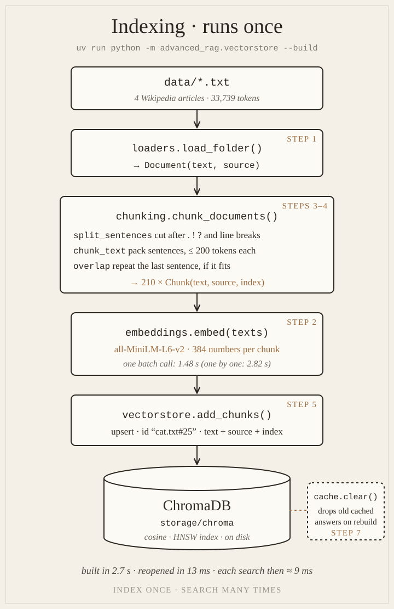
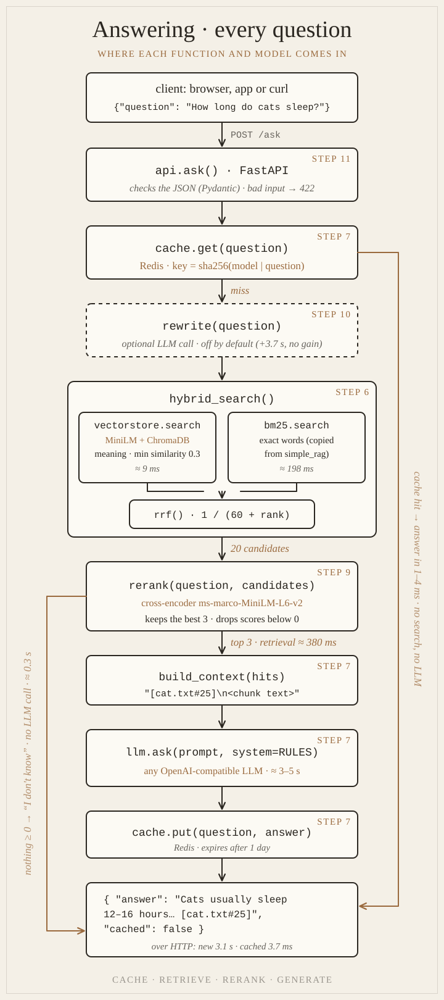
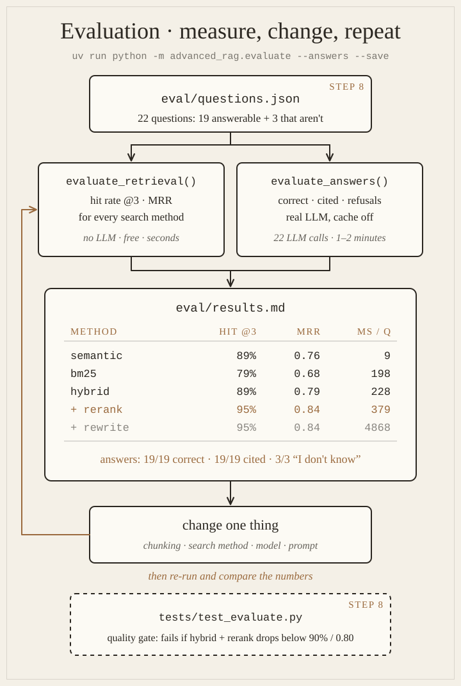

# Diagrams

Advanced RAG is really **three loops**:
1. **Indexing** runs once, whenever the documents change.
2. **Answering** runs on every question.
3. **Evaluation** runs whenever you change something, to prove whether it helped.

Each picture shows which function and which model does what, which step builds it, and the times we measured. Use them as a map: when a step feels abstract, find its box here.

---

## 1. Indexing: runs once

| Box | Function | File | Step | Model |
|---|---|---|---|---|
| data/*.txt | – | `data/` | [3](step-03-chunking-split-and-pack.md) | 4 Wikipedia articles, 33,739 tokens |
| Load | `load_folder()` | `src/advanced_rag/loaders.py` | [1](step-01-project-setup.md) | – |
| Chunk | `chunk_documents()` → `split_sentences`, `chunk_text`, overlap guard | `src/advanced_rag/chunking.py` | [3](step-03-chunking-split-and-pack.md), [4](step-04-chunking-overlap-and-records.md) | the tokenizer of all-MiniLM-L6-v2 counts tokens (≤ 200 per chunk) |
| Embed | `embed(texts)` (one batch) | `src/advanced_rag/embeddings.py` | [2](step-02-embeddings-and-dimensions.md) | **all-MiniLM-L6-v2**, 384 numbers per chunk |
| Store | `add_chunks()` (upsert, id `cat.txt#25`) | `src/advanced_rag/vectorstore.py` | [5](step-05-chromadb-vector-store.md) | – |
| ChromaDB | `get_collection()` | `src/advanced_rag/vectorstore.py` | [5](step-05-chromadb-vector-store.md) | cosine, HNSW index, saved in `storage/chroma` |
| Clear cache | `cache.clear()` | `src/advanced_rag/cache.py` | [7](step-07-redis-cache.md) | runs on `--build`, because new chunks can change answers |

**Measured:** 210 chunks embedded and stored in 2.7 s; reopening the index takes 13 ms.

---

## 2. Answering: every question

| Box | Function | File | Step | Model | Measured |
|---|---|---|---|---|---|
| API | `ask()` on `POST /ask` | `src/advanced_rag/api.py` | [11](step-11-fastapi.md) | – | bad input → 422 |
| Cache check | `cache.get(question)` | `src/advanced_rag/cache.py` | [7](step-07-redis-cache.md) | Redis | hit: 1–4 ms |
| Rewrite (off) | `rewrite(question)` | `src/advanced_rag/retrieval/rewrite.py` | [10](step-10-query-rewriting.md) | the LLM | +3.7 s, no gain on the eval set |
| Meaning | `vectorstore.search()` | `src/advanced_rag/vectorstore.py` | [5](step-05-chromadb-vector-store.md) | all-MiniLM-L6-v2 + ChromaDB | ≈ 9 ms |
| Exact words | `bm25.search()` | `src/advanced_rag/retrieval/bm25.py` | [6](step-06-hybrid-retrieval.md) | – | ≈ 198 ms |
| Fuse | `hybrid_search()` → `rrf()` | `src/advanced_rag/retrieval/hybrid.py` | [6](step-06-hybrid-retrieval.md) | – | 20 candidates |
| Rerank | `rerank(question, candidates)` | `src/advanced_rag/retrieval/rerank.py` | [9](step-09-reranking.md) | **cross-encoder ms-marco-MiniLM-L6-v2** | retrieval total ≈ 380 ms |
| No answer | (empty hits) | `src/advanced_rag/rag.py` | [9](step-09-reranking.md) | – | "I don't know" in ≈ 0.3 s, no LLM call |
| Augment | `build_context(hits)` | `src/advanced_rag/rag.py` | [7](step-07-redis-cache.md) | – | labels chunks `[cat.txt#25]` |
| Generate | `ask(prompt, system=RULES)` | `src/advanced_rag/llm.py` | [7](step-07-redis-cache.md) | any OpenAI-compatible LLM | ≈ 3–5 s |
| Remember | `cache.put(question, answer)` | `src/advanced_rag/cache.py` | [7](step-07-redis-cache.md) | Redis | expires after 1 day |
| Response | `Answer(answer, cached)` | `src/advanced_rag/api.py` | [11](step-11-fastapi.md) | – | over HTTP: 3.1 s new, 3.7 ms cached |

The two side paths are what make it fast and honest: the **cache hit** path (right) skips everything, and the **nothing relevant** path (left) skips the LLM.

---

## 3. Evaluation: measure, change, repeat

| Box | Function | File | Step | What it measures |
|---|---|---|---|---|
| Golden set | `load_questions()` | `eval/questions.json` | [8](step-08-evaluation.md) | 22 questions: 19 answerable + 3 that aren't |
| Retrieval | `evaluate_retrieval()` | `src/advanced_rag/evaluate.py` | [8](step-08-evaluation.md) | hit rate @3 and MRR for every search method, no LLM |
| Answers | `evaluate_answers()` | `src/advanced_rag/evaluate.py` | [8](step-08-evaluation.md) | correct, cited, refused: real LLM, cache off |
| Results | `report_markdown()` (`--save`) | `eval/results.md` | [8](step-08-evaluation.md) | the numbers, committed, so you can compare later |
| Quality gate | `test_retrieval_quality_does_not_drop` | `tests/test_evaluate.py` | [8](step-08-evaluation.md), [9](step-09-reranking.md) | fails if hybrid + rerank drops below 90% / 0.80 |

| Method | Hit rate @3 | MRR | ms / question |
|---|---|---|---|
| semantic | 89% | 0.76 | 9 |
| bm25 | 79% | 0.68 | 198 |
| hybrid | 89% | 0.79 | 228 |
| **hybrid + rerank** | **95%** | **0.84** | 379 |
| + rewrite | 95% | 0.84 | 4,868 |

Answers with hybrid + rerank: **19/19 correct, 19/19 cited, 3/3 "I don't know"** when the answer isn't in the articles.

---

**Back to:** [Advanced RAG overview](README.md) · **Theory:** [Concepts](concepts.md) · **Start:** [Step 1: Project setup →](step-01-project-setup.md)
